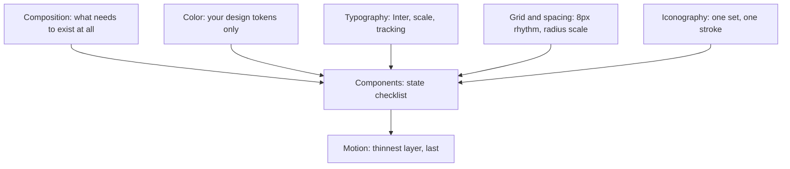
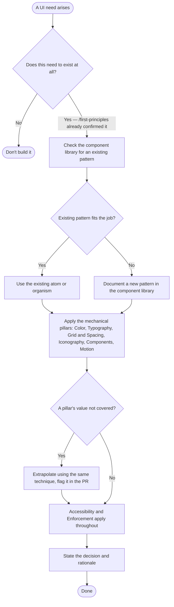

# /elegant-ui — Elegant UI

**What:** Apply literal UI standards to any UI decision. These standards are reverse-engineered from two references everyone agrees look expensive — Linear and beautifului.dev — with only the accent color swapped for your own brand accent. Nothing here is invented. **Colours are the exception: every colour comes from your project's own design tokens (e.g. the theme variables in a `globals.css`), never from the measured reference values** (see `references/color.md`).

**Why:** Building UI by taste requires a designer's judgment call every time, and produces a slow, subjective back-and-forth when the result doesn't land. Copying verified values from products that already look right removes the judgment call — a decision becomes "does this match the extracted number," not "does this look good," which is checkable by anyone, not just a designer.

**How:** Six pillars, each backed by a reference file with the exact copied values, plus a "Common mistakes" section naming the recurring bad patterns to recognize and avoid. Identify which pillar the decision touches, open that file, use the value as-is. Don't invent a new value even if the reference file doesn't cover the exact case — extrapolate from the nearest documented value using the same technique (e.g. the same lightness-step formula, the same tracking-scales-with-size rule), and note in the PR description if a genuinely new value was introduced so it can be added to the reference file later.

---

## Pillars



Composition runs first and is actually three separate questions, not one: does this feature need to exist (not this skill's job — see `references/composition.md`), which existing pattern answers it (your component library, e.g. in Storybook), and does each individual element inside that pattern earn its place (the necessity test — this skill's actual job). Everything else only applies to what survives all three.

Cutting across all seven, not pillars themselves: **Accessibility** (a bar every pillar must clear) and **Enforcement** (nothing here is automatically checked — verify real code before trusting it as precedent). Both live in `references/accessibility-and-enforcement.md`.

| Pillar | Reference file | Covers |
|---|---|---|
| Composition | `references/composition.md` | The three-question split (feature necessity → which pattern → element necessity), the atom/organism catalogue, the Storybook-check workflow |
| Color | `references/color.md` | Canvas/card/border/shadow/text values, elevation, semantic colors, the categorical-tag formula |
| Typography | `references/typography.md` | Font, type scale, size-dependent tracking, tabular numerals |
| Grid & Spacing | `references/grid-and-spacing.md` | 8px grid, the ownership rule, the border-radius scale |
| Iconography | `references/iconography.md` | Icon set, stroke width, sizing relative to text |
| Components | `references/components.md` | Proportion (input/button height parity), the component state checklist |
| Motion | `references/motion.md` | Duration/easing tokens, the four-test rule, performance and reduced-motion rules |
| Accessibility & Enforcement | `references/accessibility-and-enforcement.md` | The accessibility bar every pillar must clear, and how to check existing code before copying it |

---

## SOP



---

## Structured Output: Elegant UI

```
▶ /elegant-ui · [Composition | Color | Typography | Grid & Spacing | Iconography | Components | Motion]
  Decision:  [value chosen]
  Source:    [reference file + which extracted value, or "extrapolated" if new]
  Status:    [in progress | done]
```

---

## Hard Rules

**Never add an element that fails the necessity test**
If removing it wouldn't lose information or capability the user needs right now, it doesn't belong on the screen — see `references/composition.md` question 3. This check happens before any styling decision, not after.

**Never build a bespoke one-off UI pattern without checking the component library first**
See `references/composition.md` question 2. A genuinely new pattern gets added to the library and documented there — not invented silently for one screen.

**Never let this skill answer "does this feature need to exist"**
That's `/first-principles`' job, not this skill's — see `references/composition.md` question 1. Applying mechanical pillars to something that shouldn't have been built at all is solving the wrong problem well.

**Never invent a value a reference file doesn't already have without extrapolating from the same technique**
Guessing reintroduces the exact subjective back-and-forth this skill exists to remove.

**Never use the brand accent outside CTAs**
It is the one deliberately swapped value — everything else is copied grayscale/near-neutral. Using it elsewhere dilutes the one signal it's supposed to carry.

**Never assume a shared component already complies with this skill**
Nothing here is automatically checked unless you add a check for it — see `references/accessibility-and-enforcement.md`. Verify the real classes in your shared components before treating existing code as a correct example to copy.

**Never change the shared component library or token file from this skill alone**
Documenting a value here is a doc-only change; applying it to the shared component library is real production code affecting every app and needs its own worktree and review, not a same-pass edit.

---

## References

| Description | File |
|---|---|
| The necessity test, the representation catalogue | `references/composition.md` |
| Canvas/card/border/shadow/text values, elevation, semantic colors, categorical-tag formula | `references/color.md` |
| Font, type scale, tracking, tabular numerals | `references/typography.md` |
| 8px grid, ownership rule, border-radius scale | `references/grid-and-spacing.md` |
| Icon set, stroke width, sizing | `references/iconography.md` |
| Proportion, the component state checklist | `references/components.md` |
| Duration/easing tokens, the four-test rule, performance rules | `references/motion.md` |
| Accessibility bar, how to check existing code before copying it | `references/accessibility-and-enforcement.md` |
