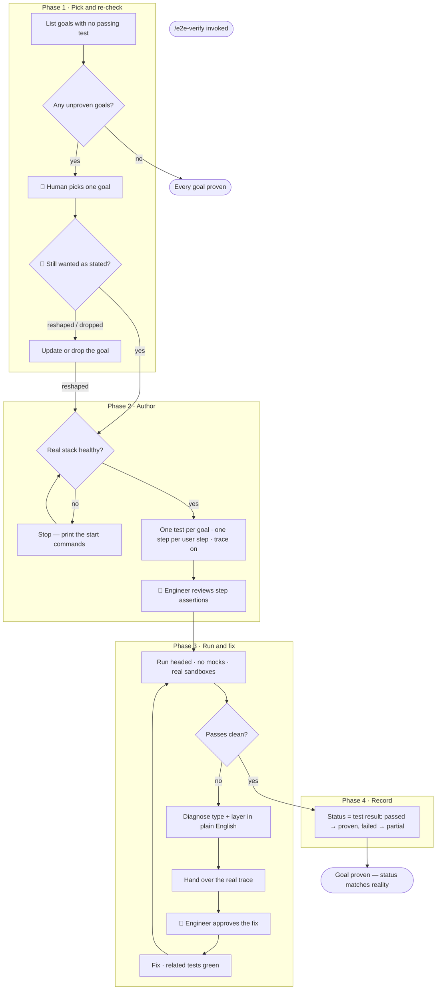

# /e2e-verify — Prove a Goal Works, For Real

**What:** Pick one user goal that is not yet proven, run it end to end against the real stack, close whatever gaps are found, and leave behind a real, re-runnable test that the goal's status is derived from.

**Why:** A goal marked "done" by hand is a claim, not proof — and a claim nothing ever re-checks is exactly how a status board quietly goes stale. Status only stays trustworthy if it is never typed at all: it is computed from whether a real, currently-passing test exists. The same holds one level up — a goal's stated intent is also a claim. A goal written months ago may no longer be what's wanted, so it gets re-checked before anything is built toward it.

**How:** Pick one unproven goal from the goal list. Confirm it is still wanted as stated. Confirm the real stack is running. Write one end-to-end test for the goal — one step per user step, in order — and have the engineer confirm each step's assertions check its stated outcome before it ever runs for real. Run it with no mocks, against real sandboxes. When it breaks, diagnose the type and layer in plain English, get approval, fix, and re-run the whole goal until it passes clean. Then record the status straight from the test run's own output.

## SOP



## Structured Output: E2E Verify

Print at the top of every response without exception:

```
▶ /e2e-verify · [phase · step]
  🎯 Goal:      [goal statement or "not yet picked"]
  📄 Test file: [path or "not yet written"]
  🧱 Layers:    [each layer the goal touches: ⏳ pending | ✅ pass | ❌ fail | ⏭️ skipped]
  🔴 Failure:   [error · <layer> | logic problem · <layer> | none]
  🏁 Status:    [picking | 🛑 awaiting intent check | authoring | 🛑 awaiting assertion review | running | 🛑 awaiting fix approval | fixing | recording | done]
```

## Hard Rules

**Intent is a claim too**
A goal's stated outcome is never assumed correct just because it is written down. Before building or fixing toward it, confirm it is still wanted as stated. The answer can be "yes," "reshaped," or "dropped" — only the first two lead to a test.

**No mocks — ever**
Run against the real local stack and real sandbox APIs. If a sandbox credential is missing, stop and surface it as a blocker before proceeding.

**One test per goal, one step per user step, in order**
Value is delivered and proven at the goal level. Every goal gets its own test, and every user step inside it gets its own named step (e.g. Playwright's `test.step()`). Never bundle two goals into one test. A goal that needs earlier state seeds it directly against the real backend — the same API the real UI calls — instead of replaying another goal's UI.

**Every step's assertions are reviewed before the test runs for real**
The engineer confirms each step checks that step's stated outcome — nothing more, nothing less. Nothing checks this again later, because status gets derived automatically from whatever this test reports.

**Status is never typed by hand**
Passed → proven. Failed → partial. No real test yet → unproven. The pass/fail, file, line and run time come straight from the test run's own output. A status that wasn't produced by an actual run is not proof.

**Never fix before the engineer approves the diagnosis**
Surface the failure, name its type (error: something threw or timed out · logic problem: it ran but produced the wrong result) and its layer, propose the fix in plain English, and stop. No edits until the engineer says to proceed.

**Diagnoses are plain English**
What was expected, what actually happened, which layer, what the fix is — one short paragraph. No stack trace or file path as the lead.

**The engineer can see it before, during, and after — never just a summary**
Before the real run: interactive step-through (e.g. Playwright `--ui`). During: headed, with each step's result streaming live. After a failure: the real trace (e.g. `playwright show-trace`). The plain-English diagnosis summarizes what the trace shows; it never replaces it.

**After any fix, re-run the whole goal**
A fix in one layer can expose a gap in another. The goal is proven only when it passes clean in one run, with every related unit and integration test green.

**A skipped layer needs a stated reason**
Mark a layer skipped only when it provably doesn't exist in this goal.

**Every proving run records a trace**
A passing result without a trace on file is not acceptable proof.

## References

| Description | File |
|---|---|
| Which kind of end-to-end test proves which kind of fact, and what each test type can and can't guarantee | `references/verification-boundaries.md` |
