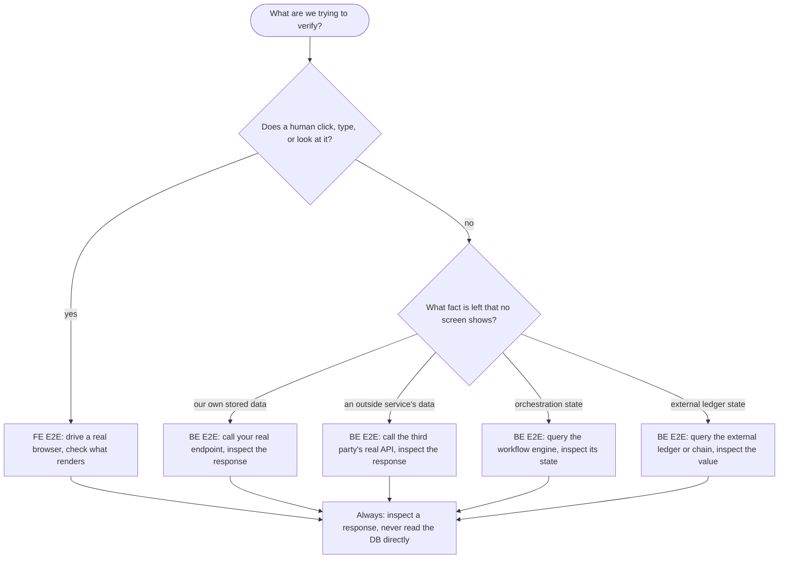

# Verification Boundaries

## FE E2E vs BE E2E

A frontend end-to-end test owns everything a human touches. A backend end-to-end test exists only to cover what's left — whatever no screen ever shows. Never read the database directly in either one; always inspect a response from whichever system is authoritative for the fact being checked.

Example: a payment goal is proven by the browser showing "Paid" (FE) *and* by the payment provider's own API reporting the charge settled (BE). A `200` from your own backend only proves the request was accepted, not that the outside system did the thing.

## What each kind of test can guarantee

Every test either fakes one real dependency on purpose to test one piece alone (**isolated**), or fakes nothing and runs against real, live systems (**full-real**).

| Test | Guarantees | Fakes on purpose | Can't see |
|---|---|---|---|
| Domain unit test | The business rule is correct, for the tested inputs | The data store | Everything outside the rule |
| Workflow integration test | Steps happen in the right order, retries and signals behave | The work each step does | The business logic inside each step |
| API integration test | Routing, auth guards and input validation are correct | The service behind the route | The data store and third parties |
| Webhook handler test | Signature check and event routing are correct | The data store and workflow client | What the workflow does next |
| FE end-to-end (full-real) | Real browser, real backend, real third party — the screen is correct | Nothing | What happens after the response returns |
| BE end-to-end (full-real) | Every backend layer's real dependency runs at once, correct end state | Nothing | The browser, deliberately |
| Resilience test (full-real) | For one deliberate disruption, the real system recovers | Nothing | Disruptions nobody thought to try |

Isolated tests are fast and pinpoint failures; only full-real tests prove the pieces are wired together. A goal is proven by a full-real test.

## Known, known unknown, unknown unknown

| Zone | Example | Mitigation |
|---|---|---|
| **Known** — fully in your control | Every test in the table above | Tests |
| **Known unknown** — real outside behavior | A third party stays down longer than your retry budget; real network congestion | Sensible retry and timeout budgets — a configuration choice, not a test |
| **Unknown unknown** — never seen yet | A failure mode nobody has imagined | Alert when something sits stuck or looks wrong — detection, not prevention |

A passing full-real test only holds within the known zone. Don't claim more than that.
