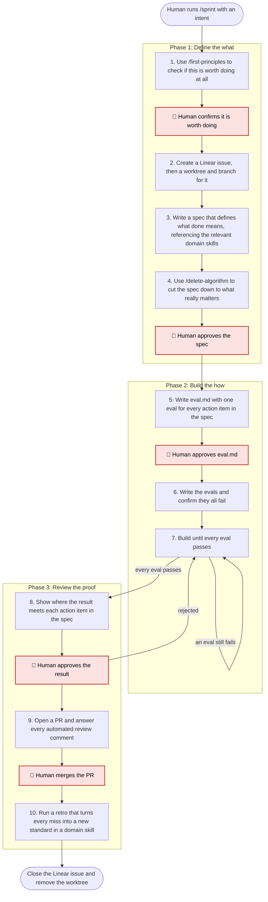

# /sprint: Define the What, Build the How, Review the Proof

**What:** Take one piece of work (code, a design, a video, a launch post) from intent to merged, in three phases.

**Why:** AI makes the how cheap, so the risk moves to the what. Work built before anyone writes down what good looks like is easy to generate and hard to check. That is where AI slop comes from. Defining done first turns every later step into a check against a written standard instead of a judgment call.

**How:** Opinionated: everything digital can be built by a coding agent and tracked in git, so every domain ships the way engineering does, with a Linear issue, a spec, an eval.md, a worktree, and a PR the human merges. What good looks like in each domain lives in its domain skill, and the spec references it. Project-specific values (which team in Linear, check commands, worktree command) come from the project's `CLAUDE.md`.

## SOP



> 🛑 means the human decides, and nothing after it starts until they do.

**Human in the loop**

| 🛑 Gate | The human decides | Nothing happens until then |
|---|---|---|
| Worth doing | This is worth building at all | Creating the Linear issue |
| Spec | What done means, after the cuts | Writing eval.md |
| eval.md | Each eval really proves its action item | Writing any eval or build code |
| Result | The result map, and every checklist eval ticked | Opening the PR |
| Merge | The PR is merged | The retro |

## Steps

| Step | What it does | Calls | Output |
|---|---|---|---|
| 1 | Checks if this is worth doing at all, whether it already exists, and whether a simpler way works | `/first-principles` | A build or skip recommendation the human confirms |
| 2 | Creates a Linear issue, then a worktree and branch named after it from a clean, synced main | | Issue ID, worktree, branch |
| 3 | Writes a spec that defines what done means, referencing the domain skills that say what good looks like for this work | `references/spec-template.md`, domain skills such as `/e2e-verify` | `spec.md` |
| 4 | Cuts every action item nothing needs and simplifies the rest, so the spec only does what really matters | `/delete-algorithm` | A shorter spec the human approves |
| 5 | Writes eval.md, turning every action item into a named eval (automated test, measured comparison, or human checklist) with the verify method from the referenced domain skill | | `eval.md` the human approves |
| 6 | Writes the evals and confirms each one fails before anything is built | | Failing evals |
| 7 | Does the minimum work that makes every eval and project check pass | | Commits |
| 8 | Shows where the result meets each action item, and flags anything done that the spec did not ask for | | A result map the human approves |
| 9 | Opens a PR and answers every automated review comment with a fix or a reason to dismiss it | | A PR the human merges |
| 10 | Turns every miss into a new standard in a domain skill, and repeated manual work into a new skill | `/new-skill` | Follow-up issues |

The spec says what done means; eval.md says how each part of it is proven. Both are built into the sprint rather than separate skills, so it works on its own. Domain skills hold what good looks like in each field: `/e2e-verify` for engineering today, more as they're added.

Details per phase: `references/phase-1-define.md`, `references/phase-2-build.md`, `references/phase-3-review.md`, `references/retro.md`.

---

## Structured Output: Sprint

Print at the top of every response without exception:

```
▶ /sprint, Phase [N] [name], Step [N] [name]
  🎫 Issue:     [ID: title | "not yet created"]
  📂 Worktree:  [directory | "not yet created"]
  🌿 Branch:    [branch | "not yet created"]
  📝 Spec:      [not yet written | written | approved]
  🧪 eval.md:   [not yet written | written | approved]
  🔗 PR:        [URL | "not yet opened"]
```

---

## Hard Rules

**What good looks like comes from a domain skill**
- **What:** Every done check in the spec references the domain skill (engineering, design, product, GTM) that defines it.
- **Why:** The sprint is the route; the standard is the destination. A standard made up inside one sprint is lost when the sprint ends; one in a domain skill gets reused and raised.
- **How:** If no domain skill covers part of the work, write the standard into the spec, mark it `(no domain skill)`, and carry it to the retro.

**Strongest available proof**
- **What:** Each eval uses the strongest proof that exists: a machine pass or fail first, a measured comparison second, a human checklist only when nothing else works.
- **Why:** An eval a human has to judge from scratch each time is the expensive verification this loop exists to avoid.
- **How:** If an eval reads "looks good" or "should work", rewrite it until someone else would get the same answer.

**Spec is locked after approval**
- **What:** After step 4, the only edit allowed is marking action items `[x]` when their evals pass.
- **Why:** A moving spec means the build is evaluated against a target that already shifted.
- **How:** Anything new found during the build becomes a new Linear issue. Split only when parts could ship and be reviewed on their own, never to hit a size target.

**Only touch what the spec names**
- **What:** The build may only create or change files named or implied by an action item.
- **Why:** A diff that wanders outside the spec can no longer be checked against it.
- **How:** Before writing any file, ask: "Is this named or implied by an action item?" If no, don't touch it.

**One issue, one worktree, one branch**
- **What:** Each sprint has exactly one Linear issue, one worktree, and one branch. Sprints can run in parallel in separate worktrees when their files don't overlap.
- **Why:** One worktree per issue keeps every diff mapped to exactly one spec, and keeps parallel sprints from touching each other.
- **How:** Work only inside the sprint's worktree. Check the directory and branch at every phase change, and halt if either is wrong.

**Write the file, print the path**
- **What:** At every gate with a file (spec.md, eval.md), write it first, then print `Review: <absolute path>` and a one or two sentence summary.
- **Why:** The human reviews in their editor, not the terminal.
- **How:** Never print file contents at a gate.

**The human merges**
- **What:** The sprint prepares everything up to the merge; the human merges.
- **Why:** Merging is where work reaches other people: the deploy, the publish, and the send all follow from it.
- **How:** Stop at step 9 and wait for the human to confirm the merge. Never run the merge yourself.

**Continuity**
- **What:** Print the status block every time.
- **Why:** A missing status block is the first sign the sprint has drifted.
- **How:** If interrupted, print the status block and ask: "Shall we continue from here?"
