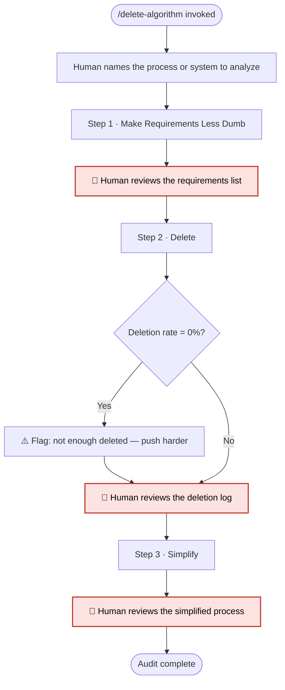

# /delete-algorithm — Elon Musk's Delete Algorithm

**What:** Walk through the first 3 steps of the Delete Algorithm in strict sequence to identify everything that should not exist.

**Why:** Engineers default to optimizing before questioning whether the thing should exist at all — this skill enforces the correct order: question, then delete, then simplify.

**How:** The human names the process, system, or list to analyze. Claude runs each step in sequence, producing a named artifact at each gate. No step begins until the human approves the prior step's artifact. The output is an audit — what can be removed and what remains — not an execution plan.

## SOP



> 🛑 means the human decides, and nothing after it starts until they do.

**Human in the loop**

| 🛑 Gate | The human decides | Nothing happens until then |
|---|---|---|
| Requirements | Each requirement serves the real goal | Deleting anything |
| Deletion log | Each cut is right, and enough was cut | Simplifying |
| Simplified process | What remains is the audit result | The audit closes |

## Steps

### Step 1 · Make Requirements Less Dumb

Ask the human to describe every requirement or constraint in the process. For each one, ask: "Does this requirement actually serve the end goal, or does it serve a process someone created to serve the end goal?" Surface any requirement that exists to satisfy another requirement rather than the actual outcome.

**Artifact:** A numbered list of all requirements, each marked as either directly serving the outcome or serving another process step.

**Exit condition:** Every requirement is labeled. No requirement survives as "we've always done it this way."

🛑 Human reviews the requirements list before Step 2 begins.

---

### Step 2 · Delete

For each item in the list, ask: "What specifically breaks if this is removed?" Cut anything that cannot be concretely answered. Log every cut — what was removed and why.

Push hard. If the deletion rate is 0%, flag it explicitly: "You deleted nothing. Musk's rule: if you are not occasionally adding things back (~10% of cuts), you are not deleting enough. Push harder."

**Artifact:** Deletion log — every removed item with a stated reason. Every surviving item with a stated reason it must stay.

**Exit condition:** Every item has a disposition. 0% deletion rate is never silently accepted.

🛑 Human reviews the deletion log before Step 3 begins.

---

### Step 3 · Simplify

For each surviving item, ask: "Can two or more of these be merged into one? Can any sub-steps be removed?" Reduce handoffs, reduce stages, reduce surface area. Document the simplified version.

**Artifact:** Simplified process — the minimum set of steps with no two steps that could be merged or one that could be cut.

**Exit condition:** The simplified process is documented. Every remaining step is irreducible.

🛑 Human reviews the simplified process. Audit complete.

---

## Structured Output: Delete Algorithm

Print at the top of every response without exception.

```
▶ /delete-algorithm · Step [N] of 3 · [step name]
  🎯 Subject:   [process or system being analyzed]
  📋 Artifact:  [artifact from this step, or "pending"]
  🔄 Status:    [in progress | awaiting approval | done]
```

## Hard Rules

**Steps run in strict sequence**
Never begin a step until the human has explicitly approved the prior step's artifact. Never reorder or skip.

**Flag a 0% deletion rate**
If nothing was deleted in Step 2, warn explicitly — the algorithm is not being applied aggressively enough.

**Default to deletion**
Every item must justify its existence. The burden of proof is on keeping, not removing.

**This is an audit, not a plan**
The output identifies what to remove and what remains. Execution is out of scope.
