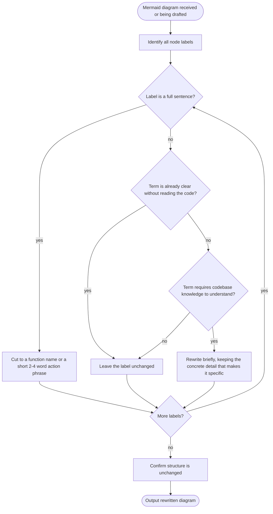

# /mermaid-concise-logic — Make Mermaid Node Labels Short and Specific

**What:** Rewrites every node label in a Mermaid diagram to be short and specific — a function name, a short verb phrase, or a well-known term — never a full prose sentence, and never an invented paraphrase of a term that was already clear. Preserves the original diagram structure and flow logic exactly.

**Why:** A long sentence crammed into a node is hard to scan and makes the diagram render badly — the reader has to stop and read a paragraph at every box instead of tracing the flow at a glance. Going the other way is just as broken: paraphrasing every identifier into invented English makes diagrams more convoluted, not less — rewriting `updated_at` as "last-changed-time," or a specific mechanism as "that property," adds a translation step instead of removing one, and the result is longer and vaguer than the original. Both failures defeat the point of a diagram: it should be graspable in seconds, and it should still say the real, specific thing.

**How:** For each node label, ask:
1. Is this a full sentence? → Cut it to a function/method name (`transfer()`, `settle()`) if one exists and fits, or a short 2–4 word action phrase (`pull totalAmount`, `send remainder → TREASURY`).
2. Does this term already require no codebase knowledge to understand — a common field name, a well-known business term, a specific mechanism already named in plain words? → Leave it as is. Do not invent a new phrase for something already clear.
3. Does this term require having read the code to understand — a bare internal variable, an obscure abbreviation? → Rewrite it briefly, keeping any concrete detail that makes it specific rather than replacing it with a vaguer placeholder.

Code identifiers are fine, and often correct, when they are the clearest and shortest label available. Leave all arrows, connections, shape types, and subgraph structure unchanged. Output the rewritten diagram only.

## SOP



## Structured Output: Mermaid Concise Logic

Print at the top of every response without exception:

```
▶ /mermaid-concise-logic
  Labels rewritten:  [count or "in progress"]
  Structure changed: no
  Status:            [in progress | done]
```

## Hard Rules

**Never change diagram structure**
Never add, remove, or rewire connections, nodes, or subgraphs. Only node label text changes.

**No full sentences in labels**
A node label is a function/method name (`transfer()`, `settle()`, `constructor()`) or a short 2–4 word action phrase (`pull totalAmount`, `send remainder → TREASURY`) — never a prose sentence. If a label reads like something spoken aloud rather than a label, cut it down.

**Code identifiers are fine when they are the clearest label**
A function name, a column name, or a specific mechanism named in plain words is not a problem to fix. Only rewrite a label that either (a) is a full sentence, or (b) requires having read the code to understand what it means.

**Never invent a paraphrase for a term that's already clear**
If a label already says the specific, true thing — in code-identifier form or in plain words — leave it. Do not restate `updated_at` as "last-changed-time," or a specific mechanism as "that property" or "the value" — the original was already exact, and the replacement is both vaguer and a false improvement.

**No `\n` in node labels**
Never use `\n` inside any node label — it does not render and causes visual clutter.

**Shape types are untouched**
Parentheses `()`, brackets `[]`, braces `{}`, and other shape delimiters define the node shape — never rewrite them as part of the label text.
